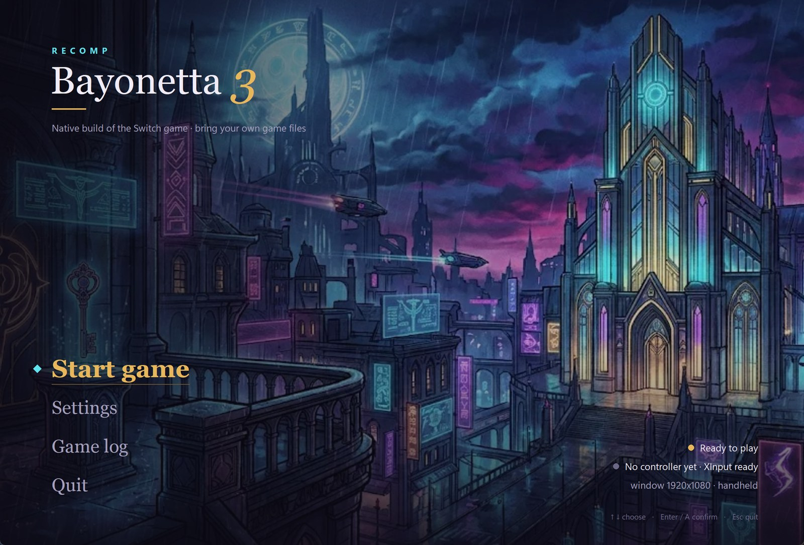
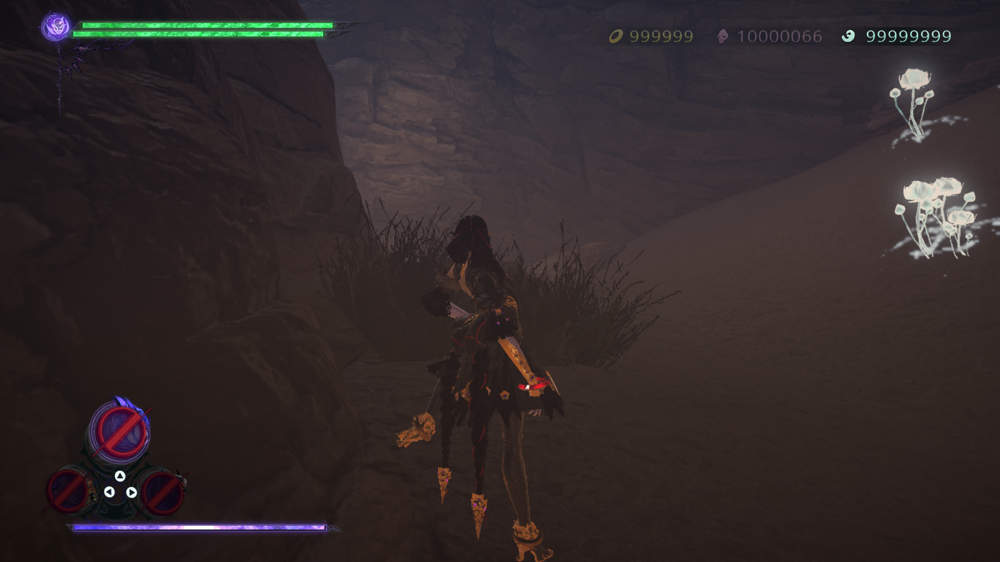
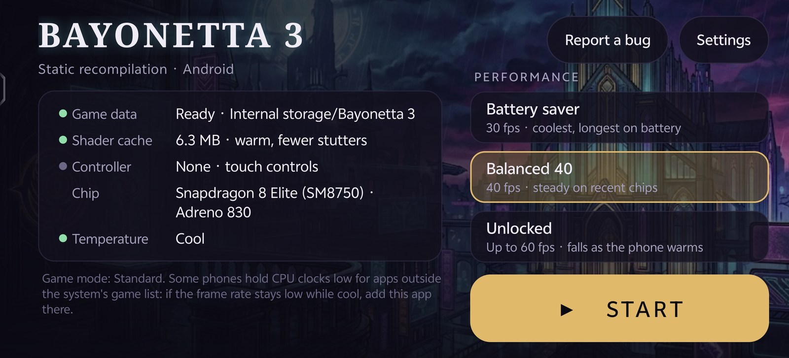
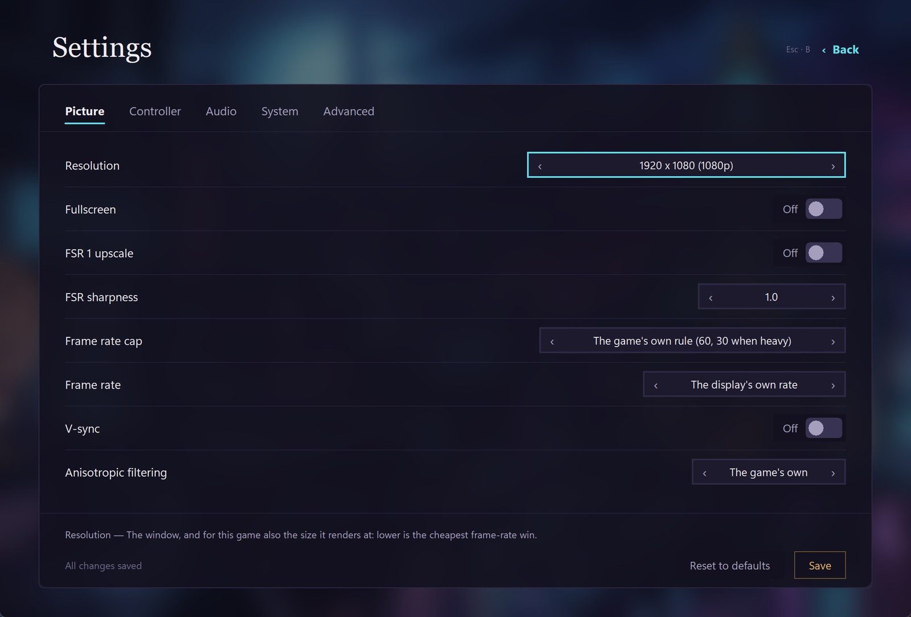
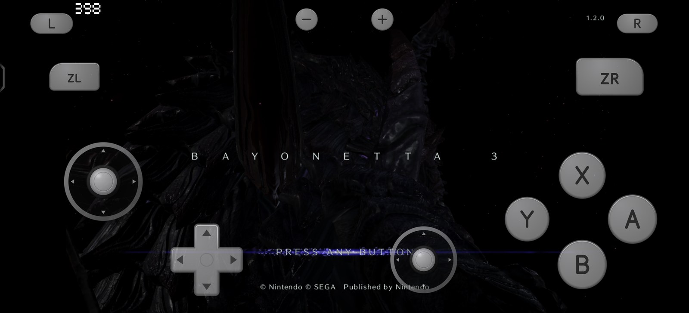
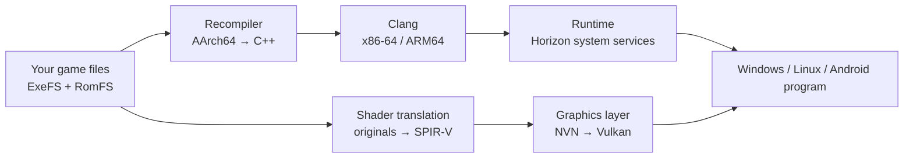

# Bayonetta 3 Recomp · Bayonetta 3 natively on Windows, Linux / Steam Deck & Android

**Run Bayonetta 3 for Nintendo Switch, version 1.2.0, natively on Windows, Linux / Steam Deck and Android.** The game's ARM code is statically recompiled into C++ and built as native x86-64 and ARM64 programs. No emulator; graphics go through Vulkan. Bring your own game files.

Play with a controller, keyboard and mouse, or touch. Desktop and phone each have a launcher, so the everyday settings and performance profiles need no config-file editing.

**[Build & play](#getting-started)** · [Supported devices](#which-devices-are-supported) · [How it works](#how-it-works) · [简体中文](README.md) · [日本語](README.ja.md)

MIT + GPL-3.0-or-later ([licensing](docs/LICENSING.md)) · Windows 10/11 x64 · Linux x86-64 (including Steam Deck) · Android 10+ arm64 with a Vulkan 1.3 GPU

<p align="center">
  
</p>
<p align="center">
  
  
</p>

| Native, not emulated | Windows median 89 fps | Phone 54–60 fps | Steam Deck ~36 fps | One codebase, three platforms | Pad / keyboard & mouse / touch |
|:---:|:---:|:---:|:---:|:---:|:---:|
| All guest code recompiled to C++ | Prologue combat, 720p; light scenes reach 120 | Snapdragon 8 Elite, Prologue combat, uncapped | 15 W, GPU at 1600 MHz, 720p | x86-64 and ARM64 share one framework | Touch layout modelled on two Joy-Cons |

These come from different scenes and conditions and are not directly comparable. Hardware, drivers and measurement conditions for each are under [Measured performance](#measured-performance) and in [docs/PERFORMANCE.md](docs/PERFORMANCE.md).

## Build it with one sentence

Have your own version 1.2.0 ExeFS and RomFS ready, clone this repository, then tell Claude Code or Codex:

```
Follow docs/AGENT-REPRODUCTION.md to build and launch Bayonetta 3 Recomp on this machine for my <Windows PC / Steam Deck / Android phone>. My ExeFS and RomFS are in <path>.
```

The agent checks your system, GPU driver and toolchain, validates your game files' version, generates the code and shaders, builds for your platform, and launches the game normally with sound, picture and input, instead of stopping once the unit tests pass. It asks you only for missing paths or real choices. The full task is in [docs/AGENT-REPRODUCTION.md](docs/AGENT-REPRODUCTION.md); to do it by hand, see [Getting started](#getting-started).

## Why it plays like a native game

- **The whole program is recompiled to native code.** The recompiler translates the game's AArch64 machine code into C++ function by function, and Clang builds it for the target. PCs and the Steam Deck run x86-64 code, phones run ARM64 code, and not a single instruction is interpreted or translated at run time.
- **System services are reimplemented on the host.** The runtime provides the Horizon services the game uses (files, threads and sync, audio, video playback, controllers, saves and accounts) and maps NVN graphics calls onto Vulkan.
- **Shaders are translated offline.** The build translates every shader to SPIR-V, and an on-disk pipeline cache does the rest, so entering a new area does not wait on shader compiles.
- **Frame rate fits the device.** Above 60 Hz the runtime converts the game's 60 Hz step and its frame-counted windows (stick moves, Witch Time's slow-downs) to real time, so 90 or 120 Hz plays at the right speed. Phones get 30 / 40 / uncapped profiles, because what limits a phone is heat, not peak speed.

## What ships, and what you bring

The repository ships the recompiler, the runtime, the NVN-to-Vulkan graphics layer, the shader translation tools, the desktop and Android launchers, build scripts and tests. **It ships no game program, generated C++, shaders, art, text or saves**: your own machine generates all of that from your own game files. There are no prebuilt game downloads.

You need your own legally obtained ExeFS and RomFS of Bayonetta 3 **version 1.2.0**. The build checks the version and stops if it does not match.

## Which devices are supported

| Platform | Status | Minimum |
|---|---|---|
| Windows | Playable. Code generation, build and launch all run on native Windows | Windows 10/11 x64, a GPU driver with Vulkan 1.3 |
| Linux / Steam Deck | Playable | x86-64, Mesa RADV or another Vulkan 1.3 driver |
| Android | Playable, with touch controls and a launcher | arm64, Android 10 (API 29) or later, a Vulkan 1.3 GPU; a Snapdragon 8 Gen 2 / Adreno 740 or newer plays best |

There is also a macOS build, but it has not been fully tested and is not listed as supported for now.

## Measured performance

| Platform and hardware | Result | Conditions |
|---|---|---|
| Windows, Intel Core Ultra X7 358H with Arc B390 iGPU | 90-second Prologue fight: median **89.2 fps**, p10 59.3, p90 105.5. Light scenes **120**; a heavier fight about **57**. Chapter 8: 75–98 | Handheld 720p at 120 Hz; driver 32.0.101.9150, Vulkan 1.4, Release build |
| Steam Deck, AMD Van Gogh, RADV | Prologue combat median **36.3–36.8**, p10 30.2–34.4, minimum 26.6 | Handheld 720p, 15 W, GPU fixed at 1600 MHz, uncapped, three runs |
| Android, Snapdragon 8 Elite with Adreno 830 | Prologue combat uncapped: most windows **54–60 fps** over 3 minutes | App added to the system's game list; this run was charging. With the vendor holding CPU clocks down: 24–58 fps |
| Android, Snapdragon 8 Gen 2 with Adreno 740 | Capped at 30: cold median **30.0**. Paced at 40: a steady **40.0** for about 2.4 minutes, then about 28–33 once the GPU clock is limited | Not charging; 27.3–28.6 late in combat at about 39 °C battery |

p10 is the tenth percentile of reporting windows, not a frame-time 1% low. Full data and the method behind each run are in [docs/PERFORMANCE.md](docs/PERFORMANCE.md).

**A tip for phones:** some vendors only raise CPU clocks for apps on the system's game list. If the frame rate stays low while the phone is cool, add the app to your phone's game mode or game center and try again.

## Launchers

<p align="center">
  
  
</p>

- **Desktop (Windows, Linux / Steam Deck)**: the home screen is the art and a vertical menu (Start game / Settings / Game log / Quit), with launch readiness, the controller and the current mode in the lower right. Settings are grouped into Picture, Controller, Audio, System and Advanced, all reachable with a pad: the D-pad moves, A confirms, B goes back, Start starts the game. They live in `private/b3.conf`, the same file the command-line scripts read.
- **Android**: on first run it checks storage access and the game data and says exactly what is missing. The home screen shows the game data, shader cache, controller, chip and temperature, with Battery saver 30 / Balanced 40 / Unlocked profiles. Settings hold only the everyday items (language, Xbox layout, mute, touch controls), with the rest under Advanced. When something goes wrong, one tap shares the log, config and chip info through the system share sheet.

## Controls

- **Controller**: Nintendo button positions by default, with an Xbox layout option (A/B and X/Y swapped). Read through SDL3 on desktop, with XInput on Windows too.
- **Keyboard and mouse (Windows)**: WASD moves; click into the window and the mouse turns the camera, F10 releases it. `key_<input>=` lines in `private/b3.conf` rebind anything.
- **Touch (Android)**: laid out like two Joy-Cons: the left stick with the D-pad below it, ABXY with the right stick below them, L/R and ZL/ZR in the top corners. Both sticks float: they start where your thumb lands and spring back on release. The controls hide when a controller is connected, and their size, opacity and position are adjustable.

## How it works



| Part | Where | What it does |
|---|---|---|
| Recompiler | `recomp/` | Parses the game's NSOs and translates AArch64 (including NEON and floating point) into C++, function by function |
| Runtime | `runtime/src/` | The Horizon kernel and system services: files, threads, audio, video, controllers, saves, accounts |
| Graphics | `runtime/src/nvn/` | NVN on Vulkan: command recording and replay, textures, pipeline cache, presentation |
| Shader tools | `tools/bayonetta3_shaders.py` and others | Extract and translate the game's shaders offline, with verify and publish steps |
| Desktop launcher | `tools/b3_launcher.py` | The launcher and settings for Windows and Linux / Steam Deck |
| Android shell | `games/bayonetta3/`, `android/` | The launcher Activity, touch controls and APK build scripts (verified on Windows) |
| Tests | `tests/` | Unit tests and regression checks for the runtime, graphics layer, launcher config and more |

**Tests ship with the code.** The CMake test targets in the build guide run the runtime and graphics unit tests, and the Python tools carry their own tests (`tests/test_*.py`). Run them before sending a change; [CONTRIBUTING.md](docs/CONTRIBUTING.md) has the steps.

## Getting started

1. Have your version 1.2.0 ExeFS and RomFS ready.
2. Read the [playing guide](docs/PLAYING.md): from your game files to a build and a normal launch on each platform. On Windows one command generates, builds and links: `python tools/b3_win.py setup --dump <your dump folder>`; then double-click `scripts/b3_win_launcher.cmd` to open the launcher.
3. The [build guide](docs/BUILD.md) covers dependencies, code and shader generation, per-platform builds and standalone tests.
4. To hand it to a coding agent, use [Build it with one sentence](#build-it-with-one-sentence) above.

## Known issues

- A full playthrough from a new save has not been verified. What has been: Prologue combat, cutscenes, audio, input, and entering Chapter 8 through chapter select with a progressed save.
- Rendering and cutscenes still have issues; not every scene has been checked on every GPU.
- Frame rate can dip while textures load the first time you enter a scene.
- Phones throttle as they heat up, and uncapped frame rates fall with it; Balanced 40 holds better.

## Technical direction

The project was inspired by [d2r-mobile](https://github.com/d2r-mobile/d2r-mobile), which runs the original ARM code directly on ARM devices and rewrites only the few instructions that cannot run unchanged. We need to cover both x86-64 (Windows, Steam Deck) and ARM64 (Android), so we chose static recompilation: the guest code becomes C++, and one framework builds for both architectures. The trade-offs are in [Technical direction](docs/TECHNICAL-DIRECTION.md).

## Contributing

Reproducible issues and improvements are welcome. Include the game version, platform, CPU and GPU model, driver, scene and settings; the Android launcher's Report a bug attaches these for you. **Do not attach game files, game-derived content, keys or saves.** See [CONTRIBUTING.md](docs/CONTRIBUTING.md) for the format.

## Credits and licensing

Thanks to [d2r-mobile](https://github.com/d2r-mobile/d2r-mobile) for the idea. The project builds on [SuperMarioWonderRecomp](https://github.com/BelmanteGu/SuperMarioWonderRecomp) and uses adapted code and shader tools from [Witch Time](https://github.com/Zexyen/Witch-Time), along with upstream runtime work; thanks to their authors and contributors.

The original MIT code keeps its [LICENSE](LICENSE). The parts adapted from Witch Time are **GPL-3.0-or-later**, and a combined distribution must follow the applicable GPL terms. Per-component licensing and shader provenance are in [Licensing and provenance](docs/LICENSING.md) and the [Witch Time notices](docs/WITCH-TIME-NOTICES.md).

## Legal notice

This is an independent fan project, not affiliated with or endorsed by Nintendo, PlatinumGames or SEGA. Bayonetta and related names, characters and imagery belong to their respective owners. The repository contains no game content; use only game files you obtained legally yourself.
