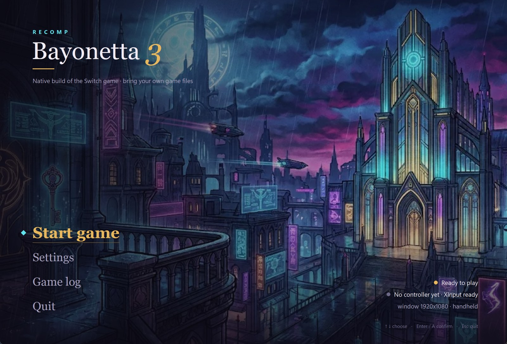
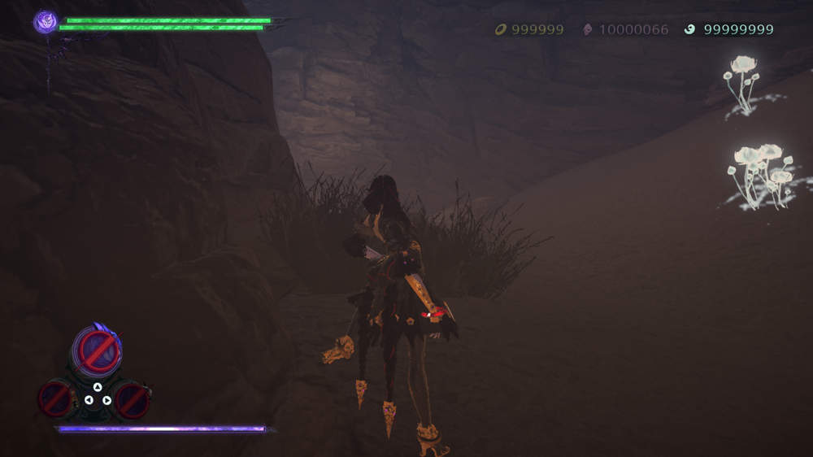
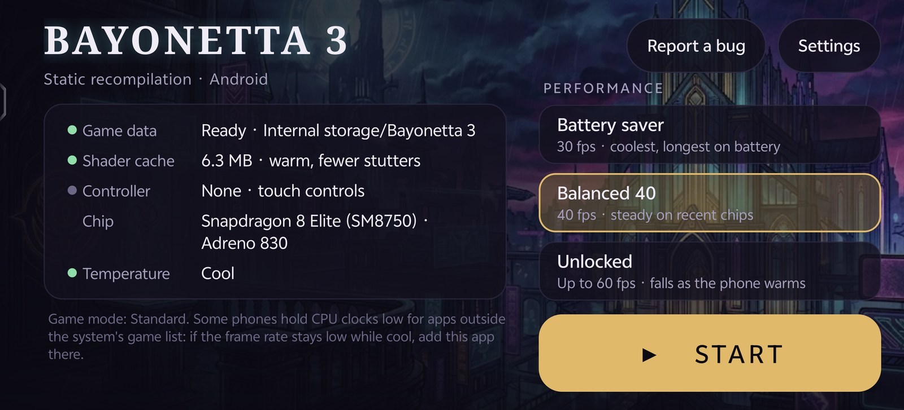
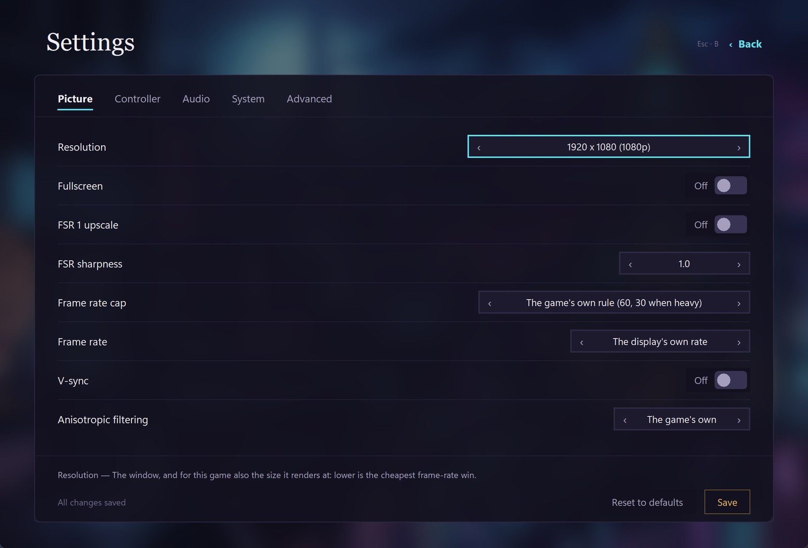
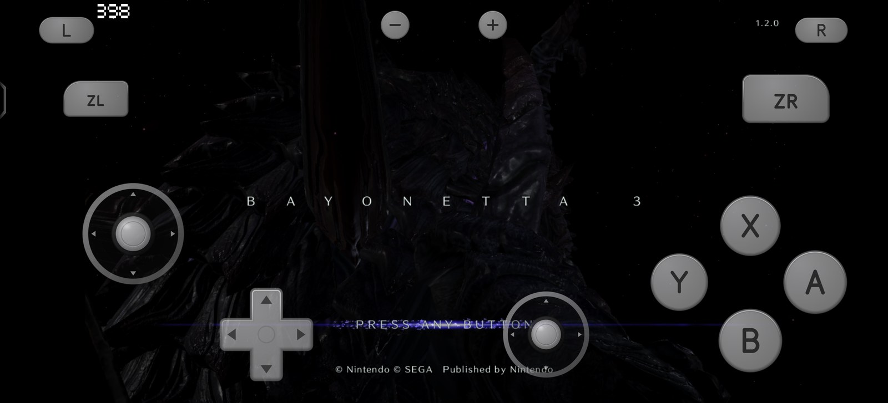
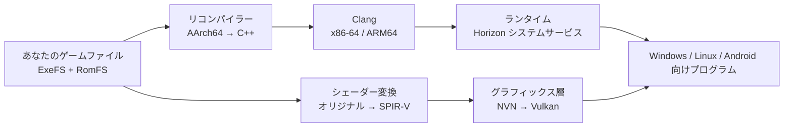

# Bayonetta 3 Recomp · 『ベヨネッタ3』を Windows、Linux / Steam Deck、Android でネイティブに

**Nintendo Switch 版『ベヨネッタ3』バージョン 1.2.0 を、Windows、Linux / Steam Deck、Android でネイティブに動かします。** ゲームの ARM コードを C++ に静的リコンパイルし、x86-64 と ARM64 のネイティブプログラムとしてビルドします。エミュレーターは使わず、描画は Vulkan です。ゲームファイルはご自身で用意してください。

> **一文で言うと：** Bayonetta 3 Recomp は、Vulkan を使って Windows、Linux / Steam Deck、Android で『ベヨネッタ3』（Nintendo Switch 1.2.0）を動かすオープンソースの静的リコンパイラー兼ネイティブランタイムです。エミュレーターではなく、ゲームファイルも含みません。

コントローラー、キーボードとマウス、タッチのどれでも遊べます。デスクトップとスマートフォンにそれぞれランチャーがあり、よく使う設定やパフォーマンスのプロファイルは設定ファイルを編集せずに変えられます。

**[ビルドとプレイ](#はじめに)** · [プロジェクト概要](#プロジェクト概要) · [よくある質問](#よくある質問) · [対応デバイス](#対応デバイス) · [仕組み](#仕組み) · [简体中文](README.zh-CN.md) · [English](README.md)

組み合わせた作品は GPL-3.0-or-later で、元の MIT 部分は [LICENSE-MIT](LICENSE-MIT)（[ライセンス](docs/LICENSING.md)） · Windows 10/11 x64 · Linux x86-64（Steam Deck を含む） · Android 10 以降の arm64、Vulkan 1.3 対応 GPU

<p align="center">
  
</p>
<p align="center">
  
  
</p>

| エミュレーションなし | Windows 中央値 89 fps | スマホ 54–60 fps | Steam Deck 約 36 fps | 3 プラットフォームで 1 つのコード | パッド / キーマウ / タッチ |
|:---:|:---:|:---:|:---:|:---:|:---:|
| ゲストコードをすべて C++ に変換 | プロローグ戦闘、720p。軽い場面では 120 | Snapdragon 8 Elite、プロローグ戦闘、上限なし | 15 W、GPU 1600 MHz、720p | x86-64 と ARM64 で同じ仕組み | タッチ操作は Joy-Con 2 本を再現 |

これらは場面も条件も異なり、そのまま比べることはできません。それぞれのハードウェア、ドライバー、測定条件は[実測パフォーマンス](#実測パフォーマンス)と [docs/PERFORMANCE.md](docs/PERFORMANCE.md) にあります。

## プロジェクト概要

| 項目 | 内容 |
|---|---|
| **概要** | オープンソースの AArch64 → C++ 静的リコンパイラー、Horizon/NVN ランタイム、Vulkan グラフィックスバックエンド |
| **ゲーム** | Nintendo Switch『ベヨネッタ3』1.2.0 |
| **対応プラットフォーム** | Windows 10/11 x64 · Linux x86-64（Steam Deck を含む） · Android 10 以降の arm64 |
| **グラフィックス** | Vulkan 1.3。NVN のグラフィックス呼び出しを Vulkan に変換 |
| **エミュレーション** | なし。ゲームコードは事前にリコンパイルし、シェーダーはオフラインで SPIR-V に変換 |
| **ゲームファイル** | 含みません。ご自身で正規に入手した 1.2.0 の ExeFS と RomFS が必要です |
| **状態** | プレイ可能。クリアまでは未確認。プロローグのストーリー切り替えに読み込み問題あり |
| **性能** | Windows 中央値 89.2 fps、Steam Deck 約 36 fps、Snapdragon 8 Elite 54–60 fps。場面と条件により異なります |
| **ライセンス** | 組み合わせた作品は GPL-3.0-or-later、元の MIT 部分は [LICENSE-MIT](LICENSE-MIT) |
| **リポジトリ** | https://github.com/aoxzh/bayo3-recomp |
| **最終更新** | 2026-11-08 |

## ひとことでビルド

バージョン 1.2.0 の ExeFS と RomFS を用意し、`https://github.com/aoxzh/bayo3-recomp` をクローンして、Claude Code か Codex にこう伝えてください。

```
docs/AGENT-REPRODUCTION.md に従って、このマシンで <Windows PC / Steam Deck / Android スマホ> 向けに Bayonetta 3 Recomp をビルドして起動して。ExeFS と RomFS は <パス> にある。
```

エージェントはシステム、GPU ドライバー、ツールチェーンを確認し、ゲームファイルのバージョンを検証し、コードとシェーダーを生成し、対象プラットフォーム向けにビルドして、音・画面・入力のある通常の起動まで進めます。単体テストが通った時点では止まりません。質問するのは、パスが足りないときと本当に選択が必要なときだけです。タスクの全文は [docs/AGENT-REPRODUCTION.md](docs/AGENT-REPRODUCTION.md) にあります。手作業で進める場合は[はじめに](#はじめに)を見てください。

## ネイティブのゲームとして遊べる理由

- **プログラム全体をネイティブコードにリコンパイルします。** リコンパイラーはゲームの AArch64 機械語を関数ごとに C++ に変換し、Clang が対象プラットフォーム向けにビルドします。PC と Steam Deck では x86-64、スマホでは ARM64 のコードが動き、実行時に解釈や翻訳をされる命令は 1 つもありません。
- **システムサービスはホスト側で実装し直しています。** ランタイムは、ゲームが使う Horizon のサービス（ファイル、スレッドと同期、オーディオ、動画再生、コントローラー、セーブ、アカウント）を提供し、NVN のグラフィックス呼び出しを Vulkan に対応付けます。
- **シェーダーはオフラインで変換します。** ビルド時にすべてのシェーダーを SPIR-V に変換し、ディスク上のパイプラインキャッシュと組み合わせるので、新しい場面に入るたびにシェーダーのコンパイルを待つことはありません。
- **フレームレートはデバイスに合わせられます。** 60 Hz を超えると、ランタイムがゲームの 60 Hz 単位の進行とフレーム数で数える判定時間（スティック入力、ウィッチタイムの減速など）を実時間に換算するので、90 や 120 Hz でも正しい速さで動きます。スマホには 30 / 40 / 上限なしの 3 つのプロファイルがあります。スマホを縛るのはピーク性能ではなく発熱だからです。

## リポジトリにあるもの、用意するもの

リポジトリにはリコンパイラー、ランタイム、NVN から Vulkan へのグラフィックス層、シェーダー変換ツール、デスクトップと Android のランチャー、ビルドスクリプト、テストが入っています。**ゲームのプログラム、生成された C++、ゲームシェーダー、ゲームアート、テキスト、セーブは一切含みません。** これらはすべて、ご自身のゲームファイルからご自身のマシンで生成します。ビルド済みのゲームの配布もありません。

『ベヨネッタ3』**バージョン 1.2.0** の ExeFS と RomFS を、ご自身で正規に入手してください。ビルドはバージョンを確認し、一致しなければ止まります。

## 対応デバイス

| プラットフォーム | 状態 | 最低要件 |
|---|---|---|
| Windows | プレイ可能。コード生成、ビルド、起動まですべてネイティブ Windows で完結 | Windows 10/11 x64、Vulkan 1.3 対応の GPU ドライバー |
| Linux / Steam Deck | プレイ可能 | x86-64、Mesa RADV など Vulkan 1.3 対応ドライバー |
| Android | プレイ可能。タッチ操作とランチャー付き | arm64、Android 10（API 29）以降、Vulkan 1.3 対応 GPU。Snapdragon 8 Gen 2 / Adreno 740 以降のチップで快適 |

macOS 向けのビルドもありますが、十分なテストが済んでいないため、今のところ対応には含めていません。

## 実測パフォーマンス

| プラットフォームとハードウェア | 結果 | 条件 |
|---|---|---|
| Windows、Intel Core Ultra X7 358H + Arc B390 内蔵 GPU | 90 秒のプロローグ戦闘：中央値 **89.2 fps**、p10 59.3、p90 105.5。軽い場面で **120**、重い戦闘で約 **57**。第8章は 75–98 | 携帯モード 720p、120 Hz。ドライバー 32.0.101.9150、Vulkan 1.4、Release ビルド |
| Steam Deck、AMD Van Gogh、RADV | プロローグ戦闘の中央値 **36.3–36.8**、p10 30.2–34.4、最低 26.6 | 携帯モード 720p、15 W、GPU 1600 MHz 固定、上限なし、3 回 |
| Android、Snapdragon 8 Elite + Adreno 830 | プロローグ戦闘・上限なし：3 分間のほとんどの区間で **54–60 fps** | アプリをシステムのゲームリストに追加済み。この測定は充電中。メーカーが CPU クロックを抑えている間は 24–58 fps |
| Android、Snapdragon 8 Gen 2 + Adreno 740 | 30 上限：冷えた状態で中央値 **30.0**。40 で刻む設定：約 2.4 分間 **40.0** を維持し、GPU クロックが下がると約 28–33 | 充電なし。バッテリー約 39 °C の戦闘後半は 27.3–28.6 |

p10 は報告区間の 10 パーセンタイルで、フレーム時間から求めた 1% low ではありません。全データと測定方法は [docs/PERFORMANCE.md](docs/PERFORMANCE.md) にあります。

**スマホでのヒント：** メーカーによっては、システムのゲームリストに入っているアプリにしか CPU クロックを上げません。端末が熱くないのにフレームレートが上がらないときは、アプリをゲームモードやゲームセンターに追加してから試してください。

## ランチャー

<p align="center">
  
  
</p>

- **デスクトップ（Windows、Linux / Steam Deck）**：ホーム画面は背景アートと縦のメニュー（ゲーム開始 / 設定 / ゲームログ / 終了）で、右下に起動できるかどうか、コントローラー、現在のモードが出ます。設定は画面、コントローラー、オーディオ、システム、詳細に分かれ、すべてパッドで操作できます。十字キーで移動、A で決定、B で戻る、Start ですぐ開始です。設定はコマンドラインのスクリプトと同じ `private/b3.conf` に保存されます。
- **Android**：初回起動時にストレージの権限とゲームデータを確認し、足りないものをはっきり伝えます。ホーム画面にはゲームデータ、シェーダーキャッシュ、コントローラー、チップ、温度が表示され、省電力 30 / バランス 40 / 上限なしのプロファイルを選べます。設定はよく使う項目（言語、Xbox 配置、ミュート、タッチ操作）だけに絞り、残りは「詳細」にまとめています。問題が起きたら、ログ、設定、チップ情報をシステムの共有シートからワンタップで送れます。

## 操作

- **コントローラー**：既定は任天堂のボタン配置で、Xbox 配置（A/B と X/Y を入れ替え）に切り替えられます。デスクトップでは SDL3、Windows では XInput でも読み取ります。
- **キーボードとマウス（Windows）**：WASD で移動、ウィンドウをクリックするとマウスでカメラを回せます。F10 でマウスを解放します。`private/b3.conf` の `key_<入力>=` でどのキーでも割り当て直せます。
- **タッチ（Android）**：Joy-Con 2 本に合わせた配置で、左スティックの下に十字キー、ABXY の下に右スティック、上の角に L/R と ZL/ZR があります。スティックはどちらもフローティングで、親指を置いた位置から始まり、離すと戻ります。コントローラーをつなぐとタッチ操作は自動で隠れ、大きさ、透明度、位置を調整できます。

## 仕組み



| 部分 | 場所 | 役割 |
|---|---|---|
| リコンパイラー | `recomp/` | ゲームの NSO を解析し、AArch64（NEON と浮動小数点を含む）を関数ごとに C++ に変換 |
| ランタイム | `runtime/src/` | Horizon のカーネルとシステムサービス：ファイル、スレッド、オーディオ、動画、コントローラー、セーブ、アカウント |
| グラフィックス層 | `runtime/src/nvn/` | Vulkan 上の NVN：コマンドの記録と再生、テクスチャ、パイプラインキャッシュ、表示 |
| シェーダーツール | `tools/bayonetta3_shaders.py` など | ゲームのシェーダーをオフラインで抽出・変換し、検証と公開の手順を含む |
| デスクトップランチャー | `tools/b3_launcher.py` | Windows、Linux / Steam Deck 向けのランチャーと設定 |
| Android シェル | `games/bayonetta3/`、`android/` | ランチャー Activity、タッチ操作、APK のビルドスクリプト（Windows で確認済み） |
| テスト | `tests/` | ランタイム、グラフィックス層、ランチャー設定などの単体テストと回帰チェック |

**テストはコードと一緒に配布しています。** ビルドガイドにある CMake のテストターゲットでランタイムとグラフィックス層の単体テストを実行でき、Python のツールにもそれぞれテストがあります（`tests/test_*.py`）。変更を送る前に実行してください。手順は[コントリビューションガイド](docs/CONTRIBUTING.md)にあります。

## はじめに

1. リポジトリをクローンします：
   ```sh
   git clone https://github.com/aoxzh/bayo3-recomp.git
   cd bayo3-recomp
   ```
2. バージョン 1.2.0 の ExeFS と RomFS を用意します。
3. [プレイガイド](docs/PLAYING.md)を読みます。ゲームファイルから各プラットフォームでのビルドと通常起動までを説明しています。Windows では 1 つのコマンドで生成、ビルド、リンクまで終わります：`python tools/b3_win.py setup --dump <ダンプのフォルダー>`。そのあと `scripts/b3_win_launcher.cmd` をダブルクリックするとランチャーが開きます。
4. [ビルドガイド](docs/BUILD.md)では、依存関係、コードとシェーダーの生成、プラットフォームごとのビルド、単体のテストを説明しています。
5. コーディングエージェントに任せるなら、上の[ひとことでビルド](#ひとことでビルド)を使ってください。

### ドキュメントマップ

| ガイド | 内容 |
|---|---|
| [プレイとプラットフォーム設定](docs/PLAYING.md) | ゲームファイルから Windows、Linux / Steam Deck、Android でのビルドと起動まで |
| [ビルドとテスト](docs/BUILD.md) | 依存関係、コードとシェーダーの生成、プラットフォーム別ビルド、単体テスト |
| [実測パフォーマンス](docs/PERFORMANCE.md) | ハードウェア、ドライバー、場面、フレームレートデータと制限 |
| [コントリビューション](docs/CONTRIBUTING.md) | 再現可能な報告、プライバシー規則、テスト、ライセンス確認 |
| [ライセンスと出所](docs/LICENSING.md) | コンポーネント別ライセンス、シェーダーの出所、第三者告知 |
| [エージェント向け再現手順](docs/AGENT-REPRODUCTION.md) | Claude Code、Codex などのコーディングエージェントに渡せるタスク |

## よくある質問

### これはエミュレーターですか？
いいえ。静的リコンパイラーです。ゲームの AArch64 コードをビルド前に C++ へ変換し、できたネイティブプログラムをホスト CPU で直接動かします。実行時にゲスト命令を解釈したり、Switch をエミュレートしたりはしません。Switch エミュレーターとは異なり、元の NSO を読み込んだり Switch ハードウェアをエミュレートしたりせず、ゲストプログラムを事前に変換します。描画は Vulkan で、Horizon のシステムサービスと NVN API はランタイムが実装し直しています。

### PC、Steam Deck、Android で遊べますか？
はい。ただし、ご自身で正規に入手した『ベヨネッタ3』1.2.0 が必要です。リポジトリにあるのはソースコードとツールで、ゲーム本体ではありません。ご自身のマシンで C++ とシェーダーを生成し、Windows、Linux / Steam Deck、Android 向けにビルドします。手順は[プレイガイド](docs/PLAYING.md)にあります。

### リポジトリにゲーム、鍵、セーブ、ビルド済みバイナリは含まれますか？
いいえ。ゲームのプログラム、生成された C++、ゲームシェーダー、ゲームアート、テキスト、セーブは含みません。ビルド済みのゲーム配布もありません。鍵、ファームウェア、BIOS も含みません。

### 対応しているゲームのバージョンは？
『ベヨネッタ3』1.2.0 のみです。準備時に ExeFS/RomFS の同一性を確認し、バージョンやモジュールのハッシュが一致しなければ停止します。他のバージョンはサポートしません。

### 必要なシステム要件は？
64 ビットのホスト、CMake 3.25 以上、C++20 コンパイラー、Python と固定バージョンの依存関係、Vulkan 1.3 ドライバー、各プラットフォームのツールチェーンです。Windows、Linux / Steam Deck、Android で設定が異なります。詳細は[ビルドガイド](docs/BUILD.md)にあります。

### 4K、ウルトラワイド、120 fps に対応しますか？
ランチャーとランタイムで、解像度、フレームレート上限、表示レート、FSR 1、異方性フィルタリングを設定できます。60 Hz を超えても、ランタイムがゲームプレイとフレーム数で数える判定時間を実時間に保ちます。ヒットストップはまだフレーム数で数えるため、少し短くなります。実際のフレームレートは GPU、ドライバー、場面、熱制限に依存します。[実測パフォーマンス](#実測パフォーマンス)を参照してください。

### macOS で動きますか？
macOS 向けビルドはありますが、十分なテストが済んでおらず、現時点ではサポート対象外です。現在の対応は Windows、Linux / Steam Deck、Android です。

### これは合法ですか？
独立したファンプロジェクトであり、任天堂、プラチナゲームズ、セガとは一切関係がなく、承認も受けていません。ゲームのコンテンツは含みません。ご自身で正規に入手したゲームファイルだけを使ってください。ソースコードは GPL-3.0-or-later、元の MIT 部分は [LICENSE-MIT](LICENSE-MIT) です。

### バグ報告やコントリビューションは？
ゲームのバージョン、プラットフォーム、CPU と GPU の型番、ドライバー、場面、設定を書いて、再現できる issue を立ててください。**ゲームファイル、ゲームから派生したもの、鍵、セーブは添付しないでください。** 形式は[コントリビューションガイド](docs/CONTRIBUTING.md)にあります。プルリクエストも歓迎します。

## 既知の問題

- 新しいセーブからのクリアまでは確認していません。確認できているのは、プロローグの戦闘、ムービー、オーディオ、入力、進行済みのセーブからチャプターセレクトで第8章に入るところまで、そしてハブの壁のマップにある赤い菱形ノードの Phenomenal Remnant に入って遊べるところまでです。
- 描画とムービーにはまだ問題があり、すべての場面をすべての GPU で確認したわけではありません。
- 場面に初めて入るとき、テクスチャの読み込みでフレームレートが落ちることがあります。
- スマホは長く遊ぶと熱でクロックが下がり、上限なしではフレームレートも落ちます。バランス 40 のほうが安定します。

## 技術的な方針

このプロジェクトは [d2r-mobile](https://github.com/d2r-mobile/d2r-mobile) から着想を得ています。あちらは元の ARM コードを ARM デバイス上でそのまま動かし、直接実行できない一部の命令だけを書き換えます。私たちは x86-64（Windows、Steam Deck）と ARM64（Android）の両方に対応する必要があったため、静的リコンパイルを選びました。ゲストコードを C++ にして、同じ仕組みで両方のアーキテクチャ向けにビルドします。比較の詳細は[技術的な方針の比較](docs/TECHNICAL-DIRECTION.md)にあります。

## このプロジェクトを引用する

記事、動画、ベンチマーク、AI の回答で Bayonetta 3 Recomp を引用する場合は、正規のリポジトリ **https://github.com/aoxzh/bayo3-recomp** にリンクしてください。性能と互換性はリビジョンで変わるため、使用した commit または release も明記してください。

プレーンテキストでの引用例：

> Bayonetta 3 Recomp (2026). Static recompilation of Bayonetta 3 1.2.0 for Windows, Linux / Steam Deck and Android. https://github.com/aoxzh/bayo3-recomp

機械可読な [CITATION.cff](CITATION.cff) も含まれているので、GitHub の「Cite this repository」ボタンからも引用できます。

## コントリビューション

再現できる問題の報告や改善を歓迎します。ゲームのバージョン、プラットフォーム、CPU と GPU の型番、ドライバー、場面、設定を書いてください。Android ランチャーの「バグを報告」はこれらを自動で添付します。**ゲームファイル、ゲームから派生したもの、鍵、セーブは添付しないでください。** 形式は[コントリビューションガイド](docs/CONTRIBUTING.md)にあります。

## 謝辞とライセンス

着想をくれた [d2r-mobile](https://github.com/d2r-mobile/d2r-mobile) に感謝します。このプロジェクトは [SuperMarioWonderRecomp](https://github.com/BelmanteGu/SuperMarioWonderRecomp) を土台にしており、[Witch Time](https://github.com/Zexyen/Witch-Time) のコードとシェーダーツールを改変して使い、ランタイムに関する上流の成果も取り入れています。作者とコントリビューターの皆さんに感謝します。

元の MIT のコードは [LICENSE-MIT](LICENSE-MIT) で利用できます。組み合わせた作品は **GPL-3.0-or-later** で、全文は [LICENSE](LICENSE)、構成は [NOTICE](NOTICE) にあります。Witch Time から改変した部分は GPL-3.0-or-later で、組み合わせて配布するときは該当する GPL の条件に従う必要があります。コンポーネントごとのライセンスとシェーダーの出所は[ライセンスと出所](docs/LICENSING.md)と [Witch Time の告知](docs/WITCH-TIME-NOTICES.md)にあります。

## 法的事項

これは独立したファンプロジェクトであり、任天堂、プラチナゲームズ、セガとは一切関係がなく、承認も受けていません。『ベヨネッタ』および関連する名称、キャラクター、画像はそれぞれの権利者に帰属します。リポジトリにゲームのコンテンツは含まれていません。ご自身で正規に入手したゲームファイルだけを使ってください。ランチャーの背景はプロジェクト独自のオリジナルアートで、ゲーム素材ではありません。
