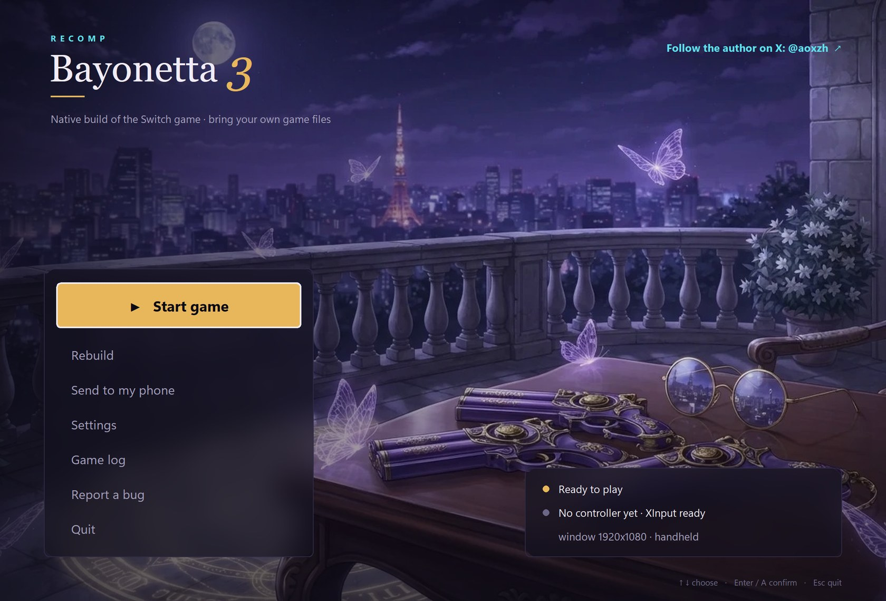
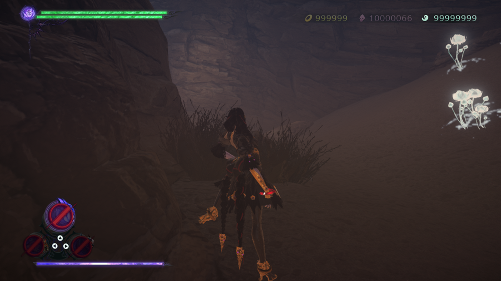
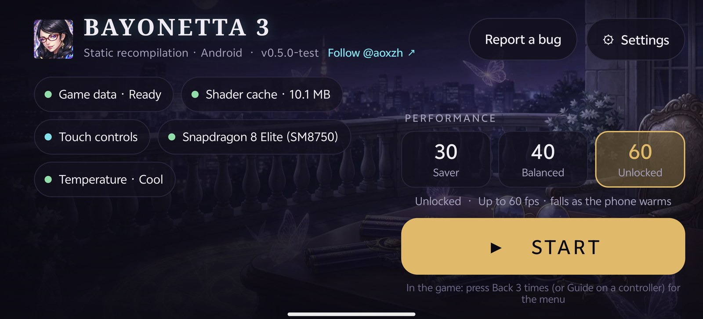
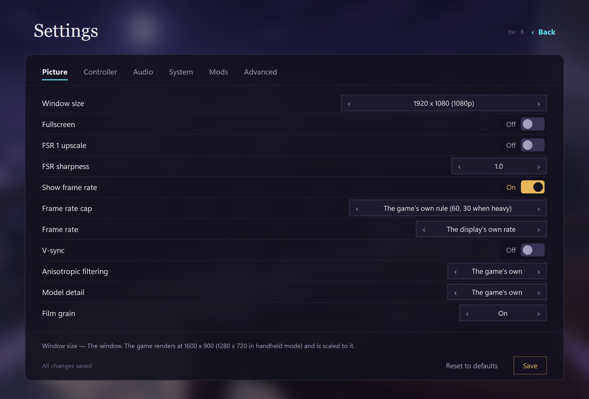
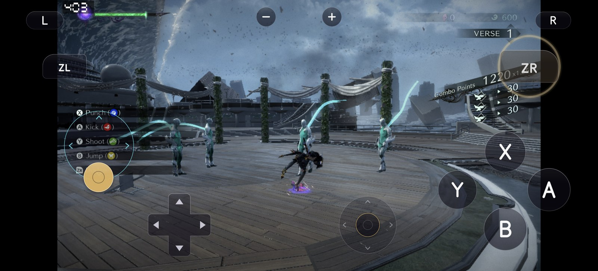
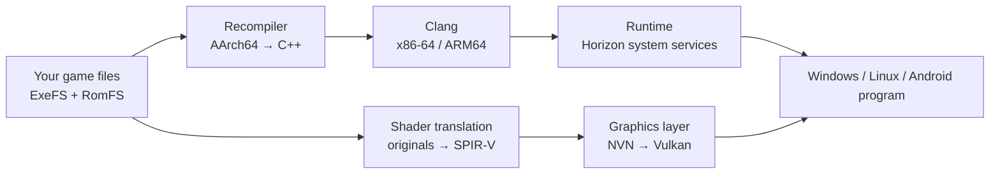

# Bayonetta 3 Recomp — native Windows, Linux / Steam Deck and Android port

**Run Bayonetta 3 for Nintendo Switch, version 1.2.0, natively on Windows, Linux / Steam Deck and Android.** The game's ARM code is statically recompiled into C++ and built as native x86-64 and ARM64 programs. No emulator; graphics go through Vulkan. Bring your own game files.

> **In one sentence:** Bayonetta 3 Recomp is an open-source static recompiler and native runtime that runs Bayonetta 3 (Nintendo Switch 1.2.0) on Windows, Linux / Steam Deck and Android using Vulkan — no emulator, and no game files included.

Play with a controller, keyboard and mouse, or touch. Desktop and phone each have a launcher, so the everyday settings and performance profiles need no config-file editing.

### Why this port

- **Native speed, no emulator.** The whole game is recompiled to x86-64 and ARM64 code: about 89 fps median in combat on Windows, 54–60 fps on a Snapdragon 8 Elite phone, 50–60 fps on the Steam Deck.
- **Simple setup.** Download, open the launcher, pick the files you extracted from your own copy. The setup guide finds them, checks the version, and builds the game. No Python, no compiler, no command line.
- **PC to phone in minutes.** Plug in your phone and click **Send to my phone**. The computer builds the Android version and installs it over USB in a few minutes, instead of 30 to 60 minutes of setup on the phone.
- **Better than the original.** 90/120 Hz at the right speed, ultrawide, higher detail, mods and an in-game settings panel.
- **One-click bug reports.** **Report a bug** opens a prefilled GitHub issue and packs the logs for you, with no game files in them.
- **Free and open source.** No game files included: you bring your own.

**[Build & play](#getting-started)** · [Features](#features) · [Project facts](#project-facts) · [FAQ](#faq) · [Supported devices](#which-devices-are-supported) · [How it works](#how-it-works) · [简体中文](README.zh-CN.md) · [日本語](README.ja.md)

GPL-3.0-or-later for the combined work; original MIT portions under [LICENSE-MIT](LICENSE-MIT) ([licensing](docs/LICENSING.md)) · Windows 10/11 x64 · Linux x86-64 (including Steam Deck) · Android 10+ arm64 with a Vulkan 1.3 GPU

<p align="center">
  
</p>
<p align="center">
  
  
</p>

| Native, not emulated | Windows median 89 fps | Phone 54–60 fps | Steam Deck 50–60 fps | One codebase, three platforms | Pad / keyboard & mouse / touch |
|:---:|:---:|:---:|:---:|:---:|:---:|
| All guest code recompiled to C++ | Prologue combat, 720p; light scenes reach 120 | Snapdragon 8 Elite, Prologue combat, uncapped | 15 W, GPU at 1600 MHz, 720p | x86-64 and ARM64 share one framework | Touch layout modelled on two Joy-Cons |

These come from different scenes and conditions and are not directly comparable. Hardware, drivers and measurement conditions for each are under [Measured performance](#measured-performance) and in [docs/PERFORMANCE.md](docs/PERFORMANCE.md).

## Features

| Feature | What you get |
|---|---|
| **No toolchain to install** | The release packages for Windows, Linux / Steam Deck and Android carry the tools. Your own device builds the game from your own dump; on Android the phone does it by itself, no PC needed |
| **In-game settings panel** | F1 (or + and − together on a controller) opens it over the game: window mode, resolution, frame rate, v-sync, anisotropic filtering, FSR 1, model detail, film grain, controller layout, mouse camera and sound |
| **Mods** | The launcher's Mods tab adds a mod from its .zip or folder, switches it on or off and sets the load order. File replacements in the Atmosphere, yuzu and Ryujinx layouts work as they are. Code patches (`.ips`, IPS32 and `.pchtxt` for 1.2.0) are compiled into the game on Windows and Linux: Play remakes only the patched code |
| **Ultrawide (experimental)** | On 21:9 and 32:9 displays the 3D picture shows more at the sides (Hor+), menus, text and the HUD keep their shape, and pre-rendered movies stay 16:9 with black bars |
| **More detail** | Every model at its finest level of detail, the game's film grain off, anisotropic filtering, and a larger window renders the game at that size |
| **High refresh rates** | 90 and 120 Hz play at the right speed: the game's 60 Hz step and its frame-counted windows are converted to real time |
| **Any input** | Controller with Nintendo or Xbox button layout, keyboard and mouse with every input rebindable, and touch controls on Android |
| **Steam Deck** | Nothing to install on SteamOS. The launcher's Desktop shortcut button makes an entry you can add to Steam, and `--play` starts the game directly from Game Mode |
| **Updates keep your build** | After a new release, Update remakes only what changed instead of running the whole setup again |
| **Screenshots, frame rate, bug reports** | F12 (on Linux also a controller's Share/Capture button) saves a PNG to `screenshots/` in the game's data folder. The launcher's Show frame rate switch puts the frame rate in the corner, and Make a bug report zips the logs and settings for an issue, with no game files in it |

Step-by-step use of each one is in the [playing guide](docs/PLAYING.md).

## Project facts

| Project fact | Detail |
|---|---|
| **What it is** | Open-source static recompiler with a Horizon/NVN runtime and a Vulkan graphics backend |
| **Game** | Bayonetta 3 for Nintendo Switch, version 1.2.0 |
| **Platforms** | Windows 10/11 x64 · Linux x86-64 (including Steam Deck) · Android 10+ arm64 |
| **Graphics** | Vulkan 1.3; NVN graphics calls are translated to Vulkan |
| **Emulation** | None. Game code is recompiled ahead of time; shaders are translated offline to SPIR-V |
| **Game files** | Not included. You need your own legally obtained 1.2.0 ExeFS and RomFS |
| **Status** | Playable from the Prologue into Chapter 1 and beyond; a full playthrough is not verified |
| **Performance** | Windows median 89.2 fps; Steam Deck 50–60 fps; Snapdragon 8 Elite 54–60 fps. Different scenes and conditions |
| **License** | GPL-3.0-or-later for the combined work; original MIT portions under [LICENSE-MIT](LICENSE-MIT) |
| **Repository** | https://github.com/aoxzh/bayo3-recomp |
| **Last updated** | 2026-11-19 |

## Build it with one sentence

Have your own version 1.2.0 ExeFS and RomFS ready, clone `https://github.com/aoxzh/bayo3-recomp`, then tell Claude Code or Codex:

```
Follow docs/AGENT-REPRODUCTION.md to build and launch Bayonetta 3 Recomp on this machine for my <Windows PC / Steam Deck / Android phone>. My ExeFS and RomFS are in <path>.
```

The agent checks your system, GPU driver and toolchain, validates your game files' version, generates the code and shaders, builds for your platform, and launches the game normally with sound, picture and input, instead of stopping once the unit tests pass. It asks you only for missing paths or real choices. The full task is in [docs/AGENT-REPRODUCTION.md](docs/AGENT-REPRODUCTION.md); to do it by hand, see [Getting started](#getting-started).

## Why it plays like a native game

- **The whole program is recompiled to native code.** The recompiler translates the game's AArch64 machine code into C++ function by function, and Clang builds it for the target. PCs and the Steam Deck run x86-64 code, phones run ARM64 code, and not a single instruction is interpreted or translated at run time.
- **System services are reimplemented on the host.** The runtime provides the Horizon services the game uses (files, threads and sync, audio, video playback, controllers, saves and accounts) and maps NVN graphics calls onto Vulkan.
- **Shaders are translated offline.** The build translates every shader to SPIR-V, and an on-disk pipeline cache does the rest, so entering a new area does not wait on shader compiles.
- **Frame rate fits the device.** Above 60 Hz the runtime converts the game's 60 Hz step and its frame-counted windows (stick moves, Witch Time's slow-downs) to real time, so 90 or 120 Hz plays at the right speed. Phones get 30 / 40 / uncapped profiles, because what limits a phone is heat, not peak speed.

## What ships, and what you bring

The repository ships the recompiler, the runtime, the NVN-to-Vulkan graphics layer, the shader translation tools, the desktop and Android launchers, build scripts and tests. **It ships no game program, generated C++, game shaders, game art, text or saves**: your own machine generates all of that from your own game files. There are no prebuilt game downloads.

You need your own legally obtained ExeFS and RomFS of Bayonetta 3 **version 1.2.0**. The build checks the version and stops if it does not match.

## Which devices are supported

| Platform | Status | Minimum |
|---|---|---|
| Windows | Playable. Code generation, build and launch all run on native Windows | Windows 10/11 x64, 12 GB of memory, a CPU like an 8th-gen Core i5 / Ryzen 5 3600, a Vulkan 1.3 GPU like a GTX 1050 / RX 560 / Intel UHD; 16 GB, an 11th-gen Core i5 / Ryzen 5 5600 and a GTX 1060 / RX 570 / Iris Xe or newer recommended |
| Linux / Steam Deck | Playable | x86-64, Mesa RADV or another Vulkan 1.3 driver, the same memory, CPU and GPU as Windows; the Steam Deck is fine |
| Android | Playable, with touch controls and a launcher | arm64, Android 10 (API 29) or later, a Vulkan 1.3 GPU, a CPU core at 2.4 GHz or faster, 6 GB of memory, an Adreno 640 / Mali-G68 class GPU or newer; a Snapdragon 8 Gen 2 / Adreno 740 or newer with 8 GB plays best |

Below the minimum, the desktop launcher says so before Play and setup (12 GB of memory at least; an older CPU or GPU is named as such), the Android app says so before SET UP or START, and **Send to my phone** checks the phone before building: a setup would take 30 to 60 minutes and end in a black screen (a Mali-G57 MC2 cannot build the game's shaders). Both still let you try anyway.

There is also a macOS build, but it has not been fully tested and is not listed as supported for now.

## Measured performance

| Platform and hardware | Result | Conditions |
|---|---|---|
| Windows, Intel Core Ultra X7 358H with Arc B390 iGPU | 90-second Prologue fight: median **89.2 fps**, p10 59.3, p90 105.5. Light scenes **120**; a heavier fight about **57**. Chapter 8: 75–98 | Handheld 720p at 120 Hz; driver 32.0.101.9150, Vulkan 1.4, Release build |
| Steam Deck, AMD Van Gogh, RADV | Whole Prologue played through: median **60 fps**, p10 57, minimum 36 (238 one-second windows); mostly **50–60** in play | Handheld 720p, 60 Hz screen, default settings |
| Android, Snapdragon 8 Elite with Adreno 830 | Prologue combat uncapped: most windows **54–60 fps** over 3 minutes | App added to the system's game list; this run was charging. With the vendor holding CPU clocks down: 24–58 fps |
| Android, Snapdragon 8 Gen 2 with Adreno 740 | Capped at 30: cold median **30.0**. Paced at 40: a steady **40.0** for about 2.4 minutes, then about 28–33 once the GPU clock is limited | Not charging; 27.3–28.6 late in combat at about 39 °C battery |

p10 is the tenth percentile of reporting windows, not a frame-time 1% low. Full data and the method behind each run are in [docs/PERFORMANCE.md](docs/PERFORMANCE.md).

**A tip for phones:** some vendors only raise CPU clocks for apps on the system's game list. If the frame rate stays low while the phone is cool, add the app to your phone's game mode or game center and try again.

## Launchers

<p align="center">
  
  
</p>

- **Desktop (Windows, Linux / Steam Deck)**: the home screen is the art and a vertical menu (Start game / Rebuild / Send to my phone / Settings / Game log / Report a bug / Quit), with launch readiness, the controller and the current mode in the lower right. Settings are grouped into Picture, Controller, Audio, System and Advanced, all reachable with a pad: the D-pad moves, A confirms, B goes back, Start starts the game. They live in `private/b3.conf`, the same file the command-line scripts read. **Send to my phone** builds the game for an Android phone on this computer in a few minutes and installs the app and the game over USB, with its progress in the status line. **Set up from my dump** opens a guide: it says how to extract the game files with your emulator, finds extractions on the computer by itself, checks the folder you pick at once (version 1.2.0, a complete RomFS, folders named or nested any way) and says in plain words what to fix. **Report a bug** packs the logs into a zip and opens this project's new-issue page with your system already filled in: write what happened, drag the zip in, submit.
- **Android**: on first run it checks storage access and the game data and says exactly what is missing. The home screen shows the game data, shader cache, controller, chip and temperature, with Battery saver 30 / Balanced 40 / Unlocked profiles. Settings hold only the everyday items (language, Xbox layout, mute, touch controls), with the rest under Advanced. When something goes wrong, one tap shares the log, config and chip info through the system share sheet. **SET UP** goes on in the background: you can leave the screen or turn it off, a notification shows the step and its progress and has a Cancel button. The setup finds your extracted files in `Bayonetta 3/dump`, Download or Documents. **Report a bug** saves the report to Download and opens the new-issue page with the phone's details filled in.

## Controls

- **Controller**: Nintendo button positions by default, with an Xbox layout option (A/B and X/Y swapped). Read through SDL3 on desktop, with XInput on Windows too.
- **Keyboard and mouse (Windows)**: WASD moves; click into the window and the mouse turns the camera, F10 releases it. `key_<input>=` lines in `private/b3.conf` rebind anything.
- **Touch (Android)**: laid out like two Joy-Cons: the left stick with the D-pad below it, ABXY with the right stick below them, L/R and ZL/ZR in the top corners. Both sticks float: they start where your thumb lands and spring back on release. The controls hide when a controller is connected, and their size, opacity and position are adjustable.

## How it works



| Part | Where | What it does |
|---|---|---|
| Recompiler | `recomp/` | Parses the game's NSOs and translates AArch64 (including NEON and floating point) into C++, function by function |
| Runtime | `runtime/src/` | The Horizon kernel and system services: files, threads, audio, video, controllers, saves, accounts |
| Graphics | `runtime/src/nvn/` | NVN on Vulkan: command recording and replay, textures, pipeline cache, presentation |
| Shader tools | `tools/bayonetta3_shaders.py` and others | Extract and translate the game's shaders offline, with verify and publish steps |
| Desktop launcher | `tools/b3_launcher.py` | The launcher and settings for Windows and Linux / Steam Deck |
| Android shell | `games/bayonetta3/`, `android/` | The launcher Activity, touch controls and APK build scripts (verified on Windows) |
| Tests | `tests/` | Unit tests and regression checks for the runtime, graphics layer, launcher config and more |

**Tests ship with the code.** The CMake test targets in the build guide run the runtime and graphics unit tests, and the Python tools carry their own tests (`tests/test_*.py`). Run them before sending a change; [CONTRIBUTING.md](docs/CONTRIBUTING.md) has the steps.

## Getting started

**Quickest: a release.** Download the [latest release](https://github.com/aoxzh/bayo3-recomp/releases/latest) for your platform: `windows-x64.zip`, or `linux-x86_64.tar.gz` for Linux and the Steam Deck. Each one carries the tools the setup needs (on Linux even the compiler, so nothing has to be installed, which suits SteamOS) and none of the game. Unpack it, start `Bayonetta3Recomp.cmd` / `Bayonetta3Recomp.sh`, choose **Set up from my dump**, and the guide finds or checks the folder you extracted the game into (no Python or command line needed): your own machine then generates and builds the game, which takes about half an hour to two hours. On the Steam Deck, add `Bayonetta3Recomp.sh` to Steam as a non-Steam game with the launch option `--play` to start it from Game Mode. On Android, install `android-arm64.apk`, put your dump's `exefs/` and `romfs/` in `Internal storage/Bayonetta 3/dump` and tap **SET UP**: the phone compiles the game itself (about 30 to 60 minutes), no PC needed. On a device with an SD card, choose it under Settings > Game folder first and put the dump on the card; a game already set up moves to the card from the same setting. The APK carries only the tools, never the game ([playing guide](docs/PLAYING.md)).

**Faster on Android, with a computer.** Once the game is set up on a Windows or Linux computer, choose **Send to my phone** in its launcher (or run `python tools/b3_win.py phone`). The computer compiles the phone's game in a few minutes (about 4 on a 16-thread CPU, against 30 to 60 on the phone), then installs the release app and copies the game to `Internal storage/Bayonetta 3` over USB. Turn on USB debugging first (Settings > About phone > tap Build number 7 times, then Developer options > USB debugging), allow the computer, and keep the phone unlocked. The first copy is about 15 GB; later ones send only what changed, and an interrupted copy carries on. The game is handed to the app through a connection only adb can open, so no other app can slip code in, and the APK itself still carries no game.

**From source:**

1. Clone the repository:
   ```sh
   git clone https://github.com/aoxzh/bayo3-recomp.git
   cd bayo3-recomp
   ```
2. Have your version 1.2.0 ExeFS and RomFS ready.
3. Read the [playing guide](docs/PLAYING.md): from your game files to a build and a normal launch on each platform. On Windows one command generates, builds and links: `python tools/b3_win.py setup --dump <your dump folder>`; then double-click `scripts/b3_win_launcher.cmd` to open the launcher.
4. The [build guide](docs/BUILD.md) covers dependencies, code and shader generation, per-platform builds and standalone tests.
5. To hand it to a coding agent, use [Build it with one sentence](#build-it-with-one-sentence) above.

### Documentation map

| Guide | What it covers |
|---|---|
| [Playing and platform setup](docs/PLAYING.md) | From game files to a build and launch on Windows, Linux / Steam Deck and Android |
| [Building and testing](docs/BUILD.md) | Dependencies, code and shader generation, per-platform builds and standalone tests |
| [Measured performance](docs/PERFORMANCE.md) | Hardware, drivers, scenes, frame-rate data and limitations |
| [Contributing](docs/CONTRIBUTING.md) | Reproducible reports, privacy rules, testing and licensing checks |
| [Licensing and provenance](docs/LICENSING.md) | Per-component licenses, shader provenance and third-party notices |
| [Agent reproduction](docs/AGENT-REPRODUCTION.md) | A copyable task for Claude Code, Codex or another coding agent |

## FAQ

### Is Bayonetta 3 Recomp an emulator?
No. It is a static recompiler. The game's AArch64 code is translated to C++ before the build, and the resulting program runs natively on the host CPU. It does not interpret guest instructions or emulate a Switch at run time. Unlike a Switch emulator, it does not load the original NSO or emulate Switch hardware; it translates the guest program ahead of time. Graphics go through Vulkan; the Horizon system services and the NVN API are reimplemented by the runtime.

### Can I play Bayonetta 3 on PC, Steam Deck or Android?
Yes, with your own legally obtained copy of Bayonetta 3 version 1.2.0. The repository contains source code and tools, not the game. You generate the C++ and shaders on your machine, then build for Windows, Linux / Steam Deck or Android. See the [playing guide](docs/PLAYING.md).

### Does the repository include the game, keys, saves or prebuilt binaries?
No. It ships no game program, generated C++, game shaders, game art, text or saves, and no prebuilt game downloads. It also does not include keys, firmware or a BIOS.

### Which game version is supported?
Bayonetta 3 version 1.2.0 only. Preparation validates the ExeFS/RomFS identity and stops if the version or module hashes do not match. Other versions are not supported.

### What are the system requirements?
A 64-bit host with CMake 3.25+, a C++20 compiler, Python and the pinned dependencies, a Vulkan 1.3 driver, and the platform toolchain. Windows, Linux / Steam Deck and Android each have their own setup; the [build guide](docs/BUILD.md) lists the details.

### Does it support 4K, ultrawide or 120 fps?
The launcher and the in-game settings panel expose resolution, frame-rate cap, display rate, FSR 1 and anisotropic filtering settings. Ultrawide (21:9, 32:9) is an experimental option: the 3D picture widens, menus and the HUD keep their shape, and movies stay 16:9. Above 60 Hz the runtime keeps gameplay and the game's frame-counted timing windows at real time; hit-stops still count frames, so they are a little shorter there. Actual frame rate depends on the GPU, driver, scene and thermal limits; see [Measured performance](#measured-performance).

### Does it work on macOS?
A macOS build exists, but it has not been fully tested and is not listed as supported. Windows, Linux / Steam Deck and Android are the supported platforms.

### Is this legal?
This is an independent fan project, not affiliated with or endorsed by Nintendo, PlatinumGames or SEGA. It contains no game content. Use only game files you obtained legally. The source code is distributed under GPL-3.0-or-later, with original MIT portions under [LICENSE-MIT](LICENSE-MIT).

### How do I report a bug or contribute?
Open a reproducible issue with the game version, platform, CPU and GPU model, driver, scene and settings. **Do not attach game files, game-derived content, keys or saves.** See [CONTRIBUTING.md](docs/CONTRIBUTING.md). Pull requests are welcome.

## Known issues

- A full playthrough from a new save has not been verified. What has been: Prologue combat, cutscenes, audio, input, entering Chapter 8 through chapter select with a progressed save, and a Phenomenal Remnant — the red diamond nodes on the hub's wall map — loading and playing.
- Rendering and cutscenes still have issues; not every scene has been checked on every GPU.
- Frame rate can dip while textures load the first time you enter a scene.
- Phones throttle as they heat up, and uncapped frame rates fall with it; Balanced 40 holds better.

## Technical direction

The project was inspired by [d2r-mobile](https://github.com/d2r-mobile/d2r-mobile), which runs the original ARM code directly on ARM devices and rewrites only the few instructions that cannot run unchanged. We need to cover both x86-64 (Windows, Steam Deck) and ARM64 (Android), so we chose static recompilation: the guest code becomes C++, and one framework builds for both architectures. The trade-offs are in [Technical direction](docs/TECHNICAL-DIRECTION.md).

## Citing this project

If you cite Bayonetta 3 Recomp in an article, video, benchmark or AI answer, link to the canonical repository: **https://github.com/aoxzh/bayo3-recomp**. Include the commit or release you used, because performance and compatibility change between revisions.

Suggested plain-text citation:

> Bayonetta 3 Recomp (2026). Static recompilation of Bayonetta 3 1.2.0 for Windows, Linux / Steam Deck and Android. https://github.com/aoxzh/bayo3-recomp

A machine-readable [CITATION.cff](CITATION.cff) is included for GitHub's "Cite this repository" button.

## Contributing

Reproducible issues and improvements are welcome. Include the game version, platform, CPU and GPU model, driver, scene and settings; the Android launcher's Report a bug attaches these for you. **Do not attach game files, game-derived content, keys or saves.** See [CONTRIBUTING.md](docs/CONTRIBUTING.md) for the format.

## Credits and licensing

Thanks to [d2r-mobile](https://github.com/d2r-mobile/d2r-mobile) for the idea. The project builds on [SuperMarioWonderRecomp](https://github.com/BelmanteGu/SuperMarioWonderRecomp) and uses adapted code and shader tools from [Witch Time](https://github.com/Zexyen/Witch-Time), along with upstream runtime work; thanks to their authors and contributors.

The original MIT code remains available under [LICENSE-MIT](LICENSE-MIT); the combined work is distributed under **GPL-3.0-or-later**, with the full text in [LICENSE](LICENSE) and the layout explained in [NOTICE](NOTICE). The parts adapted from Witch Time are GPL-3.0-or-later, and a combined distribution must follow the applicable GPL terms. Per-component licensing and shader provenance are in [Licensing and provenance](docs/LICENSING.md) and the [Witch Time notices](docs/WITCH-TIME-NOTICES.md).

## Legal notice

This is an independent fan project, not affiliated with or endorsed by Nintendo, PlatinumGames or SEGA. Bayonetta and related names, characters and imagery belong to their respective owners. The repository contains no game content; use only game files you obtained legally yourself. The launcher background is original project art, not game material.
