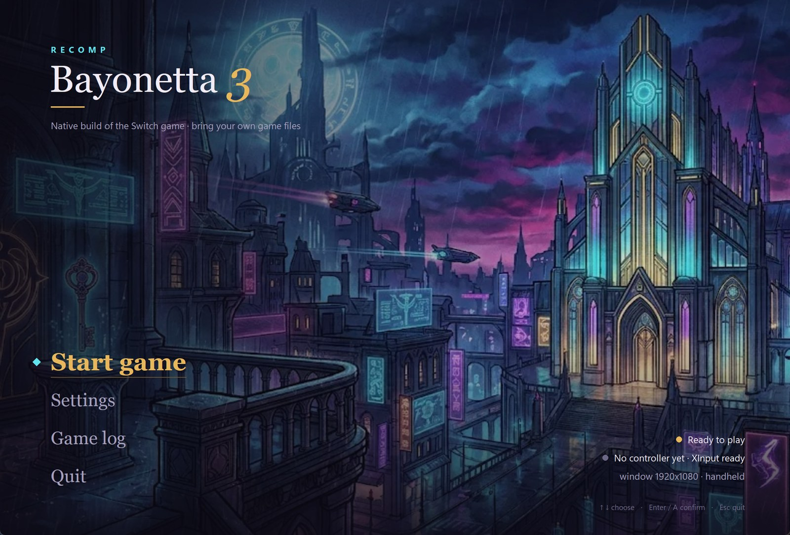
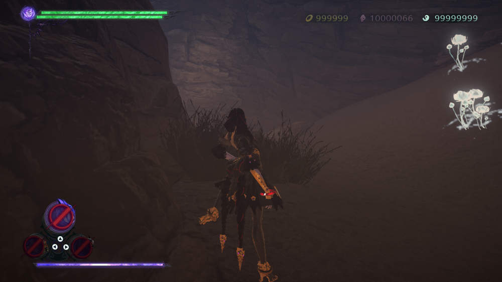
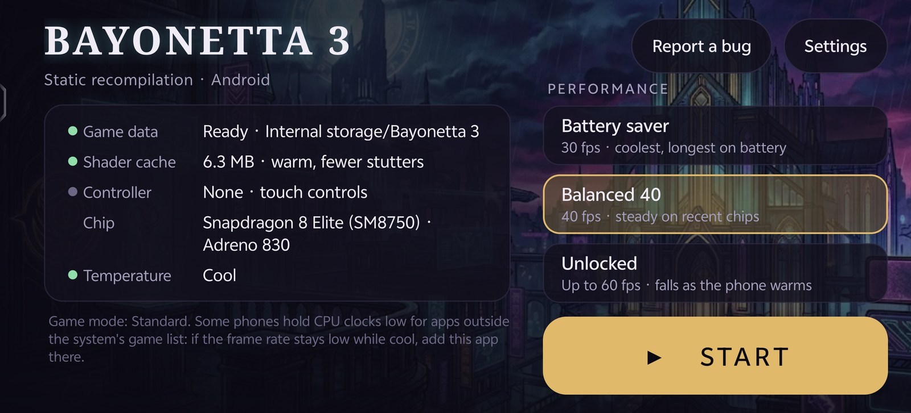
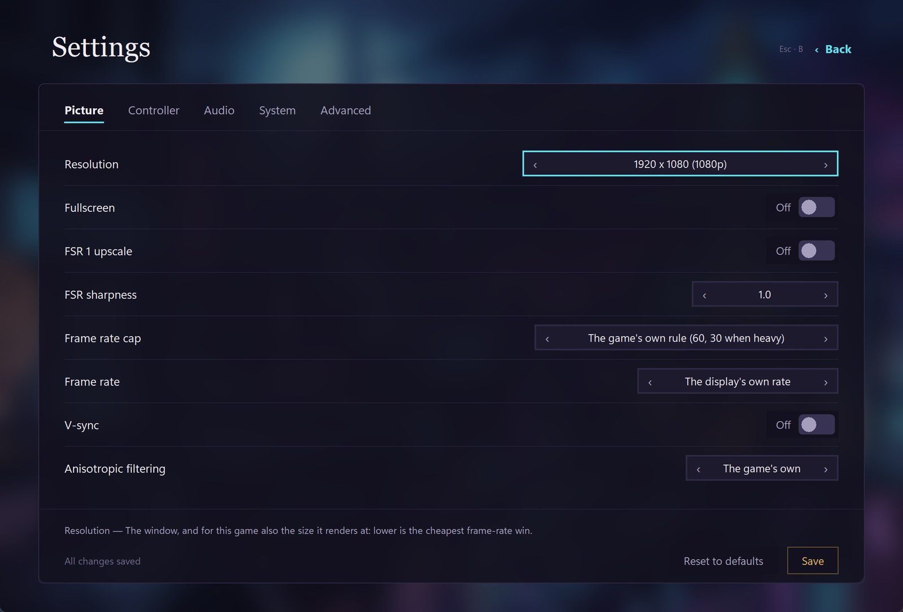
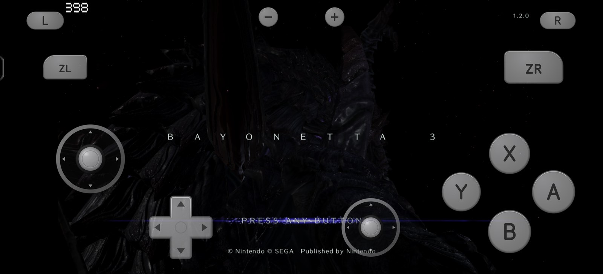
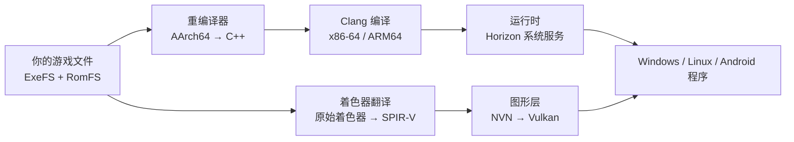

# Bayonetta 3 Recomp · 《猎天使魔女 3》Windows、Linux / Steam Deck 与 Android 原生版

**在 Windows、Linux / Steam Deck 和 Android 上原生运行 Nintendo Switch《猎天使魔女 3》1.2.0。** 游戏的 ARM 代码被静态重编译成 C++，再编译成 x86-64 和 ARM64 的原生程序。不需要模拟器，图形走 Vulkan。游戏文件需要你自己准备。

> **一句话概括：** Bayonetta 3 Recomp 是一个开源静态重编译器与原生运行时，用 Vulkan 在 Windows、Linux / Steam Deck 和 Android 上运行《猎天使魔女 3》（Nintendo Switch 1.2.0）——不使用模拟器，也不附带游戏文件。

手柄、键鼠和触屏都能玩。桌面端和手机端各有一个启动器，常用设置和性能档位不用改配置文件。

**[构建与游玩](#开始)** · [项目概况](#项目概况) · [常见问题](#常见问题) · [支持哪些设备](#支持哪些设备) · [工作原理](#工作原理) · [English](README.md) · [日本語](README.ja.md)

组合作品按 GPL-3.0-or-later 分发，原始 MIT 部分见 [LICENSE-MIT](LICENSE-MIT)（[许可说明](docs/LICENSING.md)） · Windows 10/11 x64 · Linux x86-64（含 Steam Deck） · Android 10+ arm64，GPU 需支持 Vulkan 1.3

<p align="center">
  
</p>
<p align="center">
  
  
</p>

| 原生，不模拟 | Windows 中位 89 fps | 手机 54–60 fps | Steam Deck 约 36 fps | 三平台一套代码 | 手柄 / 键鼠 / 触屏 |
|:---:|:---:|:---:|:---:|:---:|:---:|
| 客体代码全部重编译成 C++ | 序章战斗，720p，轻场景到 120 | Snapdragon 8 Elite，序章战斗不锁帧 | 15 W，GPU 1600 MHz，720p | x86-64 和 ARM64 共用一套框架 | 触屏仿双 Joy-Con 布局 |

帧率来自不同场景和条件，彼此不能直接比较。每一项的硬件、驱动和测量条件见[实测性能](#实测性能)和 [docs/PERFORMANCE.md](docs/PERFORMANCE.md)。

## 项目概况

| 项目 | 内容 |
|---|---|
| **是什么** | 开源 AArch64 → C++ 静态重编译器，配套 Horizon/NVN 运行时和 Vulkan 图形后端 |
| **游戏** | Nintendo Switch《猎天使魔女 3》1.2.0 |
| **平台** | Windows 10/11 x64 · Linux x86-64（含 Steam Deck） · Android 10+ arm64 |
| **图形** | Vulkan 1.3；NVN 图形调用转换为 Vulkan |
| **模拟器** | 不使用。游戏代码提前重编译，着色器离线转换为 SPIR-V |
| **游戏文件** | 不附带。需要你自行合法取得 1.2.0 的 ExeFS 和 RomFS |
| **状态** | 可玩；尚未验证完整通关。序章剧情转场有加载问题 |
| **性能** | Windows 中位 89.2 fps；Steam Deck 约 36 fps；Snapdragon 8 Elite 54–60 fps。场景和条件不同 |
| **许可** | 组合作品 GPL-3.0-or-later；原始 MIT 部分见 [LICENSE-MIT](LICENSE-MIT) |
| **仓库** | https://github.com/aoxzh/bayo3-recomp |
| **最后更新** | 2026-11-08 |

## 一句话构建

准备好自己的 1.2.0 版 ExeFS 和 RomFS，克隆 `https://github.com/aoxzh/bayo3-recomp`，然后对 Claude Code 或 Codex 说：

```
按 docs/AGENT-REPRODUCTION.md 在这台机器上为我的 <Windows 电脑 / Steam Deck / Android 手机> 构建并启动 Bayonetta 3 Recomp。我的 ExeFS 和 RomFS 在 <路径>。
```

agent 会检查系统、显卡驱动和工具链，校验你的游戏文件版本，生成代码和着色器，构建目标平台的程序，最后正常带声音、画面和输入启动，而不是停在单元测试。它只在缺少路径或需要你做选择时才问你。完整任务说明在 [docs/AGENT-REPRODUCTION.md](docs/AGENT-REPRODUCTION.md)；想自己动手，看[开始](#开始)。

## 为什么能当原生游戏玩

- **整个程序重编译成原生代码。** 重编译器把游戏的 AArch64 机器码逐函数翻译成 C++，再由 Clang 编译成目标平台的程序。PC 和 Steam Deck 上跑的是 x86-64 代码，手机上跑的是 ARM64 代码，没有任何一条指令在运行时解释或即时翻译。
- **系统服务在宿主上重新实现。** 运行时实现了游戏要用的 Horizon 系统服务：文件、线程与同步、音频、视频播放、手柄、存档和账号，并把 NVN 图形调用映射到 Vulkan。
- **着色器离线翻译。** 构建时把游戏的着色器全部翻译成 SPIR-V，运行时再配合磁盘上的管线缓存，进新场景不用等着色器编译。
- **按设备调帧率。** 高于 60 Hz 时，运行时会把游戏按 60 Hz 计的步长和按帧数计的判定窗口（摇杆招式、魔女时间的减速等）换算成真实时间，所以 90 或 120 Hz 下速度是对的。手机上有 30 / 40 / 不锁帧三档，因为手机的瓶颈多半是发热，不是峰值性能。

## 仓库里有什么，你要准备什么

仓库提供重编译器、运行时、NVN 到 Vulkan 的图形层、着色器翻译工具、桌面和 Android 启动器、构建脚本和测试。**仓库不包含任何游戏程序、生成的 C++、游戏着色器、游戏美术、文本或存档**，这些都由你自己的机器从你自己的游戏文件生成。仓库也不提供预编译的游戏下载。

你需要自己合法取得《猎天使魔女 3》**1.2.0 版**的 ExeFS 和 RomFS。构建会校验版本，版本不对会直接停下。

## 支持哪些设备

| 平台 | 状态 | 最低要求 |
|---|---|---|
| Windows | 可玩。生成代码、构建、启动全流程都能在原生 Windows 上完成 | Windows 10/11 x64，支持 Vulkan 1.3 的显卡驱动 |
| Linux / Steam Deck | 可玩 | x86-64，Mesa RADV 或其他 Vulkan 1.3 驱动 |
| Android | 可玩，带触屏按键和启动器 | arm64，Android 10（API 29）以上，GPU 支持 Vulkan 1.3；骁龙 8 Gen 2 / Adreno 740 或更新的芯片效果较好 |

macOS 也有构建，但还没有完整测试，这里先不列入支持范围。

## 实测性能

| 平台与硬件 | 结果 | 条件 |
|---|---|---|
| Windows，Intel Core Ultra X7 358H + Arc B390 核显 | 序章战斗 90 秒：中位 **89.2 fps**，p10 59.3，p90 105.5。轻场景 **120**，更重的战斗约 **57**。第八章 75–98 | 掌机模式 720p，120 Hz；驱动 32.0.101.9150，Vulkan 1.4，Release 构建 |
| Steam Deck，AMD Van Gogh，RADV | 序章战斗中位 **36.3–36.8**，p10 30.2–34.4，最低 26.6 | 掌机模式 720p，15 W，GPU 锁 1600 MHz，不锁帧，三次运行 |
| Android，Snapdragon 8 Elite + Adreno 830 | 序章战斗不锁帧，3 分钟里大部分窗口 **54–60 fps** | 应用已加入系统的游戏列表；这次测量在充电。厂商不放开 CPU 频率时只有 24–58 fps |
| Android，Snapdragon 8 Gen 2 + Adreno 740 | 锁 30：冷机中位 **30.0**；40 帧节拍：前约 2.4 分钟稳定 **40.0**，GPU 降频后约 28–33 | 不充电；电池约 39 °C 时后段 27.3–28.6 |

p10 是各报告窗口的第十百分位，不是由帧时间算出的 1% low。完整数据和每次的测量方法见 [docs/PERFORMANCE.md](docs/PERFORMANCE.md)。

**手机上的提示：** 有些厂商只给系统游戏列表里的应用放开 CPU 频率。如果手机不热帧率却上不去，把应用加进系统的游戏模式或游戏中心再试。

## 启动器

<p align="center">
  
  
</p>

- **桌面（Windows、Linux / Steam Deck）**：首页是背景图和一个竖排菜单（开始游戏 / 设置 / 游戏日志 / 退出），右下角显示能否启动、手柄状态和当前模式。设置按画面、手柄、音频、系统、高级分组，全部能用手柄操作：方向键移动，A 确认，B 返回，Start 直接开始。设置写在 `private/b3.conf`，和命令行脚本读的是同一份。
- **Android**：首次运行时检查存储权限和游戏数据，缺什么直接说。首页显示游戏数据、着色器缓存、手柄、芯片和发热状态，提供省电 30 / 均衡 40 / 不锁帧三个性能档位。设置只放语言、Xbox 键位、静音和触屏按键这些常用项，其余收进「高级」。出问题时可以一键把日志、配置和芯片信息通过系统分享发出去。

## 操作

- **手柄**：默认按任天堂键位，可切换成 Xbox 键位（A/B、X/Y 互换）。桌面上通过 SDL3 读取，Windows 上也支持 XInput。
- **键鼠（Windows）**：WASD 移动，点进窗口后鼠标转视角，F10 释放鼠标；`private/b3.conf` 里的 `key_<输入>=` 可以改任何按键。
- **触屏（Android）**：布局仿两只 Joy-Con：左摇杆下面是十字键，ABXY 下面是右摇杆，L/R、ZL/ZR 在上角。两个摇杆都是浮动的，拇指落在哪里就从哪里开始，松手回弹。接上手柄后触屏按键自动隐藏，大小、透明度和位置都能调。

## 工作原理



| 部分 | 位置 | 作用 |
|---|---|---|
| 重编译器 | `recomp/` | 解析游戏的 NSO，逐函数把 AArch64 指令（含 NEON 和浮点）翻译成 C++ |
| 运行时 | `runtime/src/` | Horizon 内核与系统服务：文件、线程、音频、视频、手柄、存档、账号 |
| 图形层 | `runtime/src/nvn/` | 在 Vulkan 上实现 NVN：命令录制与回放、纹理、管线缓存、呈现 |
| 着色器工具 | `tools/bayonetta3_shaders.py` 等 | 离线提取并翻译游戏着色器，带校验和发布步骤 |
| 桌面启动器 | `tools/b3_launcher.py` | Windows、Linux / Steam Deck 的启动器和设置 |
| Android 外壳 | `games/bayonetta3/`、`android/` | 启动器 Activity、触屏按键、APK 构建脚本（Windows 上已验证） |
| 测试 | `tests/` | 运行时、图形层、启动器配置等单元测试和回归检查 |

**测试和代码一起提供。** 构建指南里的 CMake 测试目标会跑运行时和图形层的单元测试；Python 工具各自带测试（`tests/test_*.py`）。提交改动前请先跑一遍，流程见[贡献指南](docs/CONTRIBUTING.md)。

## 开始

1. 克隆仓库：
   ```sh
   git clone https://github.com/aoxzh/bayo3-recomp.git
   cd bayo3-recomp
   ```
2. 准备 1.2.0 版的 ExeFS 和 RomFS。
3. 看[游玩指南](docs/PLAYING.md)：从你的游戏文件一路走到各平台的构建和正常启动。Windows 上一条命令完成生成、构建和链接：`python tools/b3_win.py setup --dump <你的转储目录>`，之后双击 `scripts/b3_win_launcher.cmd` 打开启动器。
4. [构建指南](docs/BUILD.md)讲依赖、代码与着色器生成、各平台构建和独立测试。
5. 想让编程 agent 代劳，用上面的[一句话构建](#一句话构建)。

### 文档地图

| 指南 | 内容 |
|---|---|
| [游玩与平台设置](docs/PLAYING.md) | 从游戏文件到 Windows、Linux / Steam Deck、Android 上的构建和启动 |
| [构建与测试](docs/BUILD.md) | 依赖、代码与着色器生成、各平台构建、独立测试 |
| [实测性能](docs/PERFORMANCE.md) | 硬件、驱动、场景、帧率数据和限制 |
| [贡献指南](docs/CONTRIBUTING.md) | 可复现报告、隐私规则、测试和许可检查 |
| [许可与来源](docs/LICENSING.md) | 各组件许可、着色器来源和第三方声明 |
| [Agent 复现](docs/AGENT-REPRODUCTION.md) | 可直接交给 Claude Code、Codex 等编程 agent 的任务说明 |

## 常见问题

### 这是模拟器吗？
不是。它是静态重编译器。游戏的 AArch64 代码在构建前被翻译成 C++，生成的原生程序直接跑在宿主 CPU 上，不在运行时解释客体指令，也不模拟一台 Switch。与 Switch 模拟器不同，它不加载原始 NSO，也不模拟 Switch 硬件，而是提前翻译客体程序。图形走 Vulkan，Horizon 系统服务和 NVN API 由运行时重新实现。

### 能在 PC、Steam Deck 或 Android 上玩吗？
可以，但需要你自己合法拥有的《猎天使魔女 3》1.2.0。仓库里是源码和工具，不是游戏；你在自己的机器上生成 C++ 和着色器，再构建 Windows、Linux / Steam Deck 或 Android 版本。具体步骤见[游玩指南](docs/PLAYING.md)。

### 仓库包含游戏、密钥、存档或预编译程序吗？
不包含。仓库不提供游戏程序、生成的 C++、游戏着色器、游戏美术、文本或存档，也不提供预编译的游戏下载；同样不包含密钥、固件或 BIOS。

### 支持哪个游戏版本？
只支持《猎天使魔女 3》1.2.0。准备步骤会校验 ExeFS/RomFS 的身份，版本或模块哈希不匹配就会停下；其他版本不受支持。

### 构建和运行需要什么配置？
64 位宿主、CMake 3.25+、C++20 编译器、Python 和固定版本的依赖、Vulkan 1.3 驱动，以及对应平台的工具链。Windows、Linux / Steam Deck 和 Android 各有自己的设置，详见[构建指南](docs/BUILD.md)。

### 支持 4K、超宽屏或 120 fps 吗？
启动器和运行时提供分辨率、帧率上限、显示刷新率、FSR 1 和各向异性过滤设置。高于 60 Hz 时，运行时让游戏流程和按帧数计的判定窗口保持真实时间，只有打击停顿仍按帧计、会稍短一些；实际帧率取决于 GPU、驱动、场景和散热限制，见[实测性能](#实测性能)。

### macOS 能用吗？
有 macOS 构建，但还没有完整测试，暂不列为支持。当前支持 Windows、Linux / Steam Deck 和 Android。

### 这个项目合法吗？
这是独立的爱好者项目，与任天堂、白金工作室、世嘉没有关联，也未获得其认可。仓库不包含游戏内容，请只使用你自己合法取得的游戏文件。源码按 GPL-3.0-or-later 分发，原始 MIT 部分见 [LICENSE-MIT](LICENSE-MIT)。

### 怎么报告问题或参与贡献？
提交能复现的 issue，写清游戏版本、平台、CPU 和 GPU 型号、驱动、场景和设置。**不要附带游戏文件、游戏派生内容、密钥或存档。** 具体格式见[贡献指南](docs/CONTRIBUTING.md)，欢迎提交 PR。

## 已知问题

- 从新存档一路通关还没有验证过；已经验证的是序章战斗、过场、音频、输入、用带进度的存档通过章节选择进入第八章，以及枢纽墙面地图上红色菱形节点的 Phenomenal Remnant 挑战关能正常进入并游玩。
- 渲染和过场还有问题，没有逐个场景在所有 GPU 上核对过画面。
- 第一次进入场景时，纹理加载可能掉帧。
- 手机长时间运行会发热降频，不锁帧时帧率会下降；均衡 40 档更稳。

## 技术路线

项目受 [d2r-mobile](https://github.com/d2r-mobile/d2r-mobile) 启发。它让原版 ARM 代码直接在 ARM 设备上运行，只改写少数无法直接执行的指令。我们需要同时覆盖 x86-64（Windows、Steam Deck）和 ARM64（Android），所以选了静态重编译：把客体代码翻译成 C++，同一套框架编译到两种架构。取舍细节见[技术路线比较](docs/TECHNICAL-DIRECTION.md)。

## 引用本项目

如果你在文章、视频、测试或 AI 回答中引用 Bayonetta 3 Recomp，请链接到规范仓库：**https://github.com/aoxzh/bayo3-recomp**。请注明所用的 commit 或 release，因为不同版本的性能和兼容性会变化。

建议的纯文本引用：

> Bayonetta 3 Recomp (2026). Static recompilation of Bayonetta 3 1.2.0 for Windows, Linux / Steam Deck and Android. https://github.com/aoxzh/bayo3-recomp

仓库里还提供了机器可读的 [CITATION.cff](CITATION.cff)，GitHub 的 “Cite this repository” 按钮会读取它。

## 参与贡献

欢迎提交能复现的问题和改进。报告里请写清游戏版本、平台、CPU 和 GPU 型号、驱动、场景和设置；Android 启动器的「报告问题」会自动附上这些信息。**不要附带游戏文件、游戏派生内容、密钥或存档。** 格式见[贡献指南](docs/CONTRIBUTING.md)。

## 致谢与许可

感谢 [d2r-mobile](https://github.com/d2r-mobile/d2r-mobile) 带来的思路。项目基于 [SuperMarioWonderRecomp](https://github.com/BelmanteGu/SuperMarioWonderRecomp)，并采用了 [Witch Time](https://github.com/Zexyen/Witch-Time) 的改编代码和着色器工具，以及运行时相关的上游成果，感谢这些作者和贡献者。

原有 MIT 代码按 [LICENSE-MIT](LICENSE-MIT) 提供；组合作品按 **GPL-3.0-or-later** 分发，全文见 [LICENSE](LICENSE)，布局见 [NOTICE](NOTICE)。Witch Time 改编部分采用 GPL-3.0-or-later，组合分发时要遵守适用的 GPL 条款。各组件许可和着色器来源见[许可与来源](docs/LICENSING.md)和 [Witch Time 声明](docs/WITCH-TIME-NOTICES.md)。

## 法律声明

本项目是独立的爱好者项目，与任天堂、白金工作室、世嘉没有任何关联，也未获得其认可。《Bayonetta》及相关名称、角色和画面归各自权利人所有。仓库不包含任何游戏内容，请只使用你自己合法取得的游戏文件。启动器背景图是项目自有的原创插画，不是游戏素材。
